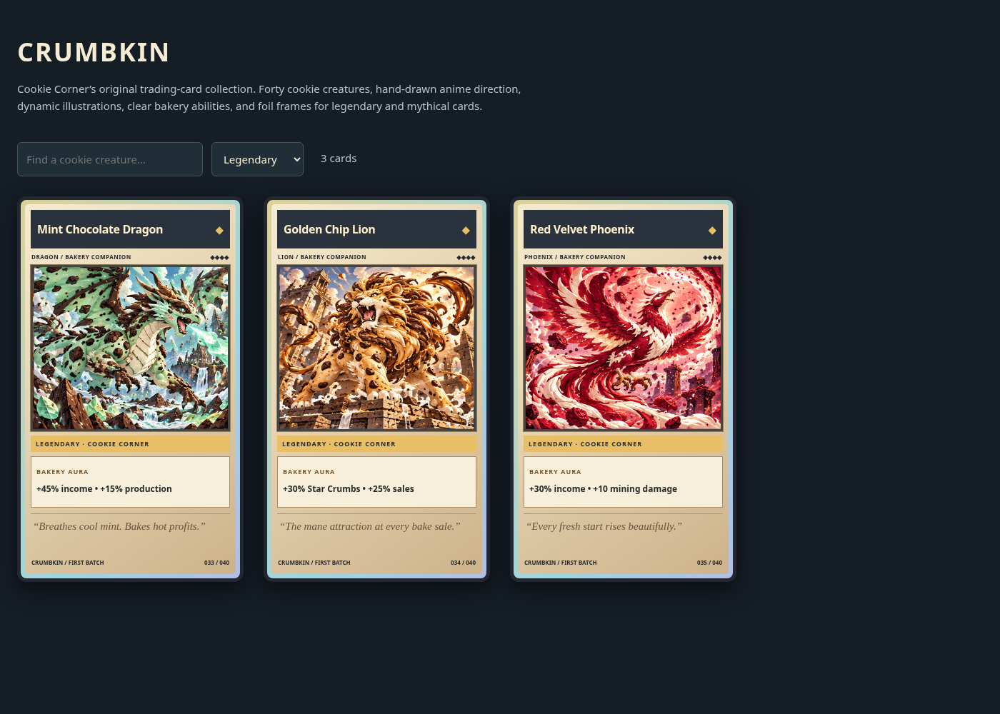

# Crumbkin TCG artwork

The forty original cookie creatures now use a hand-drawn anime TCG direction: crisp ink outlines, cel shading, action poses, themed environments, and more elaborate rare/legendary/mythical scenes. The game adds its own nameplates, rarity marks, ability boxes, flavor text, collector numbers and animated foil frames. These are original cookie creatures and an original frame design.

The art is delivered in **four 5-column × 2-row illustration sheets**, ten animals per image:

| Image | Card numbers |
| --- | --- |
| CookieTCG_01.png | 001–010 |
| CookieTCG_02.png | 011–020 |
| CookieTCG_03.png | 021–030 |
| CookieTCG_04.png | 031–040 |

**Preview.png** shows the finished card designs and is included in the Studio ZIP. An optional **Gallery.html** remains in this source folder for developers; it is not included in the Studio download and is not used by the Roblox game.

## Use the illustrated cards in Roblox

For a beginner walkthrough covering both the card sheets and audio, see [Upload audio and TCG artwork](https://github.com/Messer252/RobloxGame/blob/main/UPLOAD-ASSETS.md).

1. Upload the four **CookieTCG_*.png** images through Studio Asset Manager or Creator Dashboard using the experience's creator account/group.
2. Open **ReplicatedStorage → CookieTycoon → CardCatalog → ArtSheets**.
3. Set each sheet's `Id = 0` to that image's numeric Roblox image asset ID. Match filenames 01 through 04; leave the supplied dimensions, grid and card ranges unchanged.
4. Publish and test all forty crops as another account. If you configured the previous single atlas, replace it with these four uploads/IDs.

Four sheets give each creature more image detail than the earlier forty-cell sheet. Roblox needs hosted image IDs; PNG files inside a local ZIP cannot supply ImageLabel textures by themselves. Native 3D previews remain available until the corresponding sheet is configured.

`CardCatalog.luau` defines names, rarities, buffs, quips and sheet mapping. `TradingCardFrame.luau` draws the original TCG face. `tools/build_card_gallery.py` rebuilds the offline gallery without modifying images. Gameplay effects, pack odds, currency and saves are unchanged by this art update.
